# Design 02 — face, upper-body and costume study

This is a partial 3D implementation of the Design 02 concept, not the finished replacement character. Lower-leg anatomy and shoes remain from the previous study. The public fight continues to load the earlier model.

## What is implemented

- A connected shaped head/neck surface with cheek, socket, brow, nose and lip relief.
- A shorter visible neck: head-weighted surfaces are lowered 0.09 authored game units with a weight-based transition through the neck. The combat skeleton, contact rules and animation remain unchanged.
- An original face-paint source baked into a unique 1024-square cylindrical UV atlas. A smooth material mask blends its sides and chin into the body skin color, removing the earlier projected portrait edge. The editable source material remains in Blender; the GLB uses a standard metallic/roughness material and its second UV set, with no custom shader requirement.
- A fitted hair cap, five curved fringe locks, side locks and three swept ponytail masses. Cross-sections follow each curve's tangent rather than remaining horizontal. The ponytail root/tie stays attached to the head and blends into the existing ponytail bone farther down the locks.
- The face bake reduced the earlier head/hair GLB from roughly 2.5 MB to 1.4 MB; the connected upper body adds geometry to that study. These are this asset's file sizes, not measured runtime performance.

The torso and both arms are now one connected mesh. Blender voxel union removes the separate shoulder shells, followed by surface smoothing, reduction and transfer of the existing skin weights. Neighboring influences blend across the shared shoulder surface, with at most four normalized weights per vertex. This is an anatomical blockout improvement; it is not a final sculpt or hand-authored deformation topology.

## Reproduce

Use compatible Blender 3.6 from the repository root:

```
blender --background --python scripts/build-tala-blender.py -- --design02
node scripts/sample-tala-design02-guard.mjs
blender --background --python scripts/render-tala-design02.py
blender --background --python scripts/render-tala-design02.py -- --guard
blender --background --python scripts/render-tala-design02.py -- --pose=straight
blender --background --python scripts/render-tala-design02.py -- --pose=cross
blender --background --python scripts/render-tala-design02.py -- --pose=hook
```

The build flag writes this directory's editable `tala-study.blend`, baked albedo and report, plus `dist/assets/models/tala-design02.glb`. Omitting the flag retains the original study output. The current 17-bone combat mapping and contact timing are preserved. Live study-model ponytail roll is capped at 0.45 radians; the earlier public model retains its existing motion.

Review at `/tala-blender.html?model=design02`. Use Inspect face, then compare front/profile and guard. The preview is explicitly labeled a study and does not offer a misleading play-with-this-model link.

## Actual renders

These are Blender CPU renders of the exported-source geometry, not generated concept art. Lighting differs from the browser. The guard renders use matrices sampled from the actual live review animator at 0.95 seconds into Guard + block, including block brace.

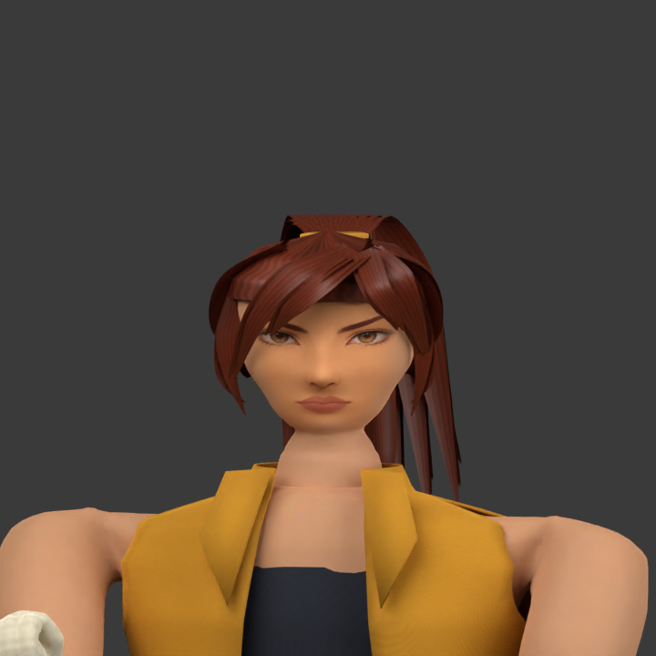
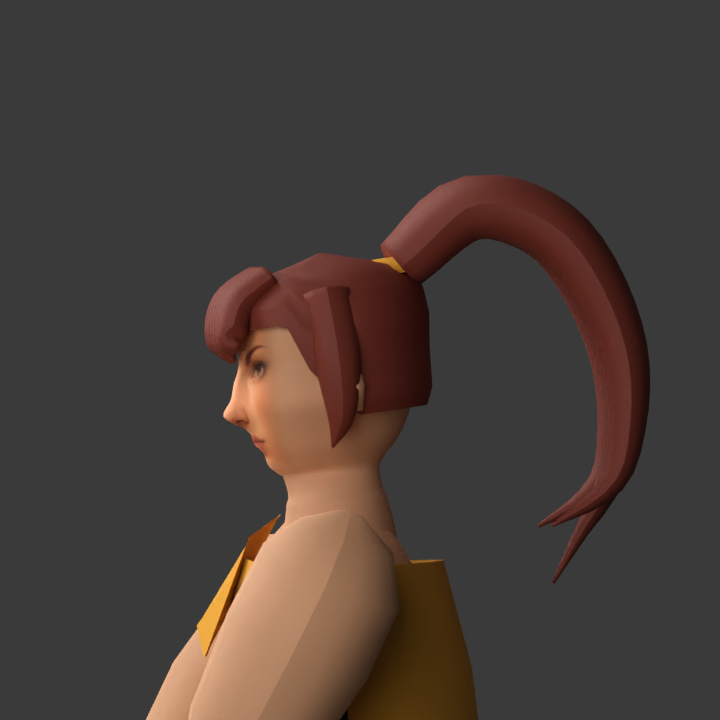
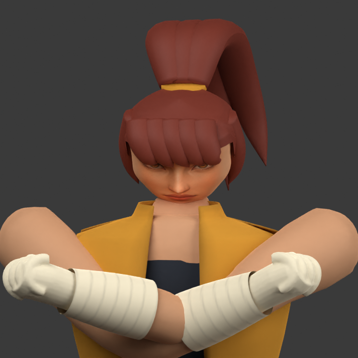
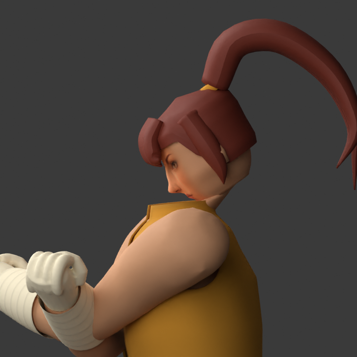

## Combo contact deformation renders

These use the actual runtime contact poses, at local strike frame 5 in each of the three combo actions. They expose the shoulder connection from two cameras; they do not prove full-speed animation quality.

| Right straight | Left cross | Right hook |
|---|---|---|
| 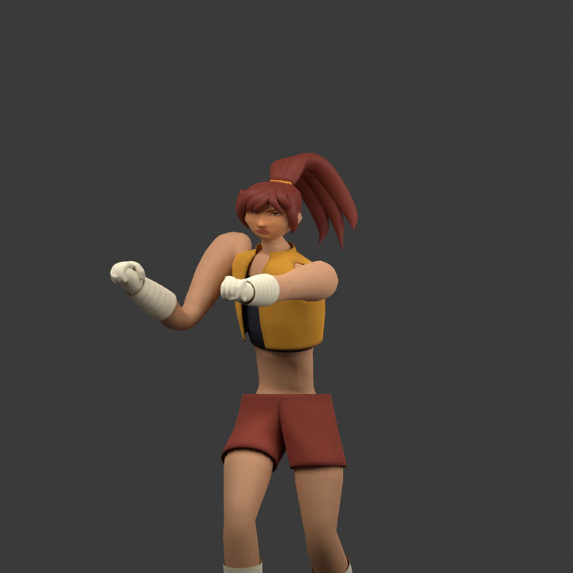 | 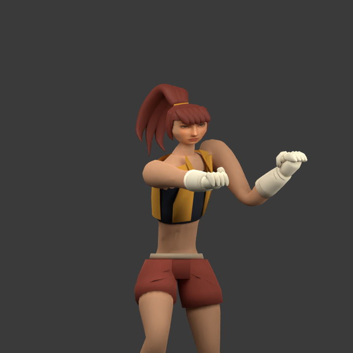 | 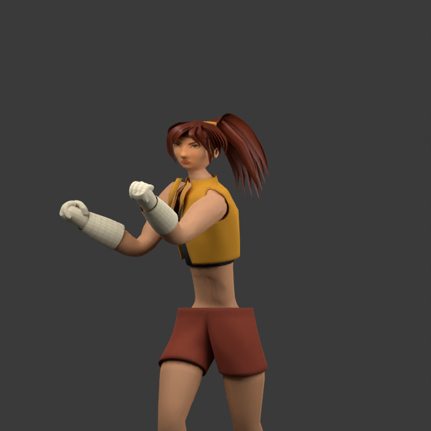 |
| 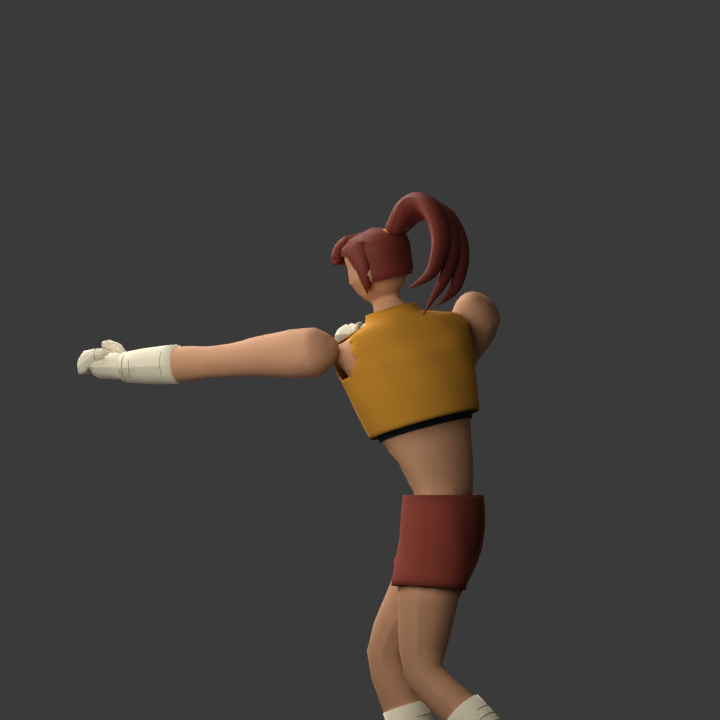 | 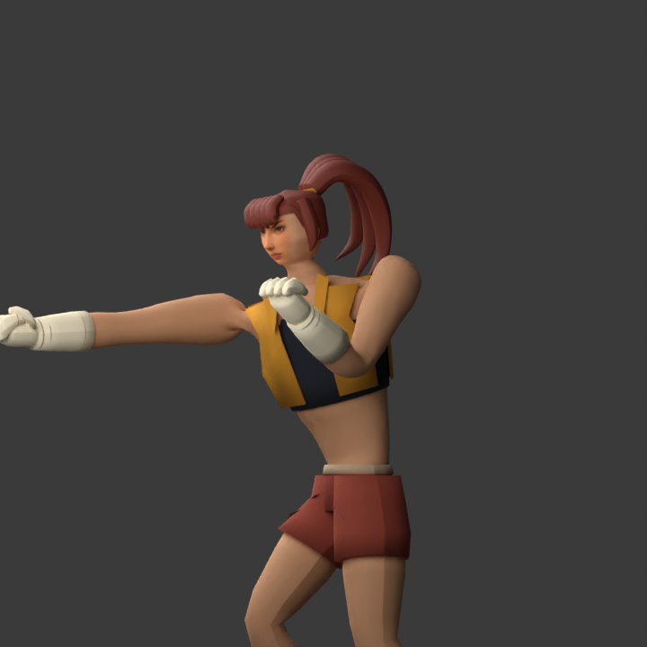 | 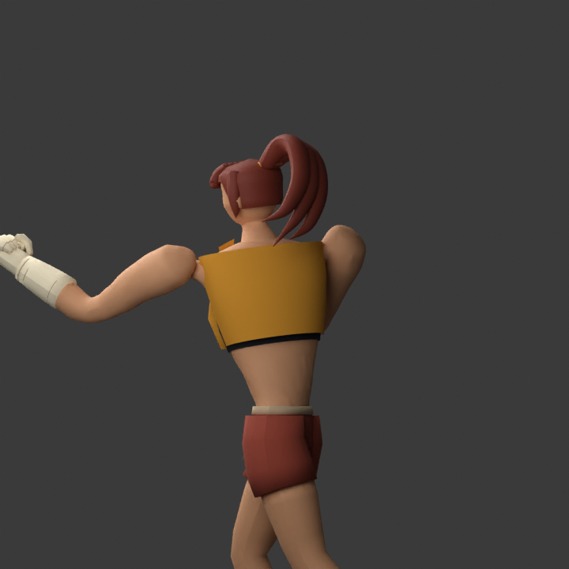 |

## Verification and limitations

The geometry tests check packed albedo, its referenced UV set, standard material export, retained 17-bone mapping, finite deformation across all live review actions and preserved guard tuck. Additional checks prove that the upper body is a single connected surface, its weights are normalized, and triangles remain bounded in guard and all three punch contact poses. They do not establish visual quality. Chrome's connection still timed out during this pass, so browser bitmap decoding, review controls and real-time playback remain unverified for this variant.

Remaining art work: more anatomical shoulder/scapula definition and deformation refinement, garment fold and collision refinement, further wrist/hand refinement, expressive eyelids/mouth and closer matching of hair silhouette/painted strand detail. The face source still contains baked shading and fine pores. Hair still uses one moving ponytail bone rather than the proposed multi-segment rig. The head is an analytic surface study, not finished facial edge-loop retopology. The shorter neck is a surface adjustment, not a redesigned skeletal pivot; review extreme head motion before promoting the asset.

Face source was created with the built-in image-generation tool from the original Design 02 reference. Exact prompt: [face-prompt.txt](face-prompt.txt). Blender performs the material bake. No third-party face texture is used.

## Tailored costume pass

The vest is now a curved sleeveless shell with an open front, actual armholes, a raised collar and thin fabric edges. The shorts use a shared inseam connecting two leg openings to one waist, replacing overlapping capped volumes. Subtle shaping and darker hems travel as standard glTF vertex colors, requiring no custom shader. This is skinned cloth, not a cloth simulation.

Rebuild with the command above, then render the whole character with `--full`.

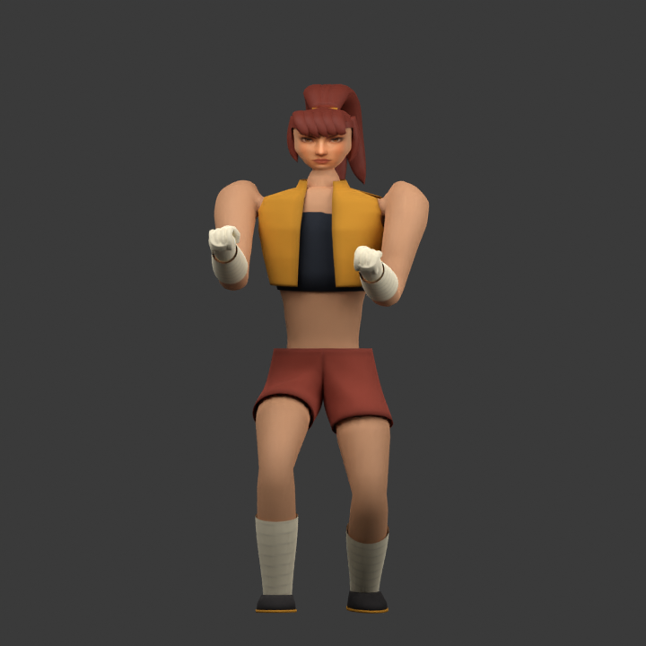
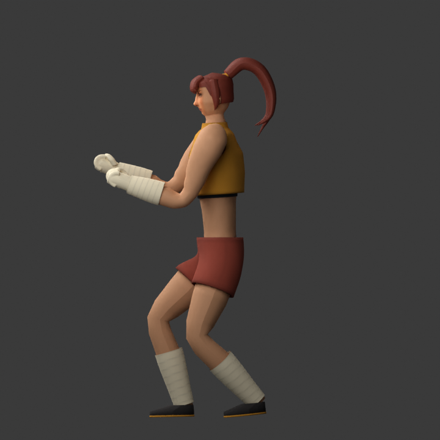

Costume verification: 239 repository tests pass, including standard vertex-color export and normalized garment weights through live actions. Full-body front/profile and guard renders were inspected. Armhole borders now follow oval curves instead of the cutout grid; shoulder fit and folds still need refinement; this pass is not a finished costume sculpt. Browser playback is still unverified.

The armhole refinement projects boundary vertices onto the authored oval and removes unused vertices inside each opening. Full-body and guard images include this refinement; the earlier combo images document the preceding costume pass.

## Closed-fist study

The separate finger blocks are replaced with a continuous wrapped palm, staggered knuckles, curled fingers and an opposing thumb. Blender voxel union joins these construction surfaces, then smoothing and reduction produce a compact surface. Both fists retain the existing one-bone hand mapping. This is a closed-fist sculpt, not articulated fingers; open-hand techniques still need dedicated shapes or finger bones. Guard and straight-punch renders are regenerated for this pass; the other images retain the previous hands.

Hand-pass verification: 240 repository tests pass. New checks verify that each fist is one connected mesh, uses the correct hand bone and stays finite at guard and all three punch contacts. The full study now has 34,426 Blender vertices across 13 meshes; this is still an art prototype and needs mesh-budget refinement before becoming the default fighter.

## Cloth wraps and faster body-only builds

The forearm and shin wraps now use continuous tapered surfaces with shallow diagonal overlap and flat vertex-color seams. This replaces separate raised ring meshes. The lower forearm blends from hand to forearm influence; shin cloth follows the shin bone. Guard and full-body costume renders show this pass; older punch images retain the preceding wrap geometry.

For body-only iterations with an unchanged face surface and source, add `--reuse-face-atlas` to the Design 02 build command. It explicitly loads the existing packed face atlas, retains the authoring material and UV mapping, and skips the CPU face bake. The default build still rebakes the face. Do not use this shortcut after changing the face geometry, UVs, source image or mask; it deliberately has no automatic stale-cache detection.

Wrap-pass verification: 241 tests pass. Guard and full-body front/profile renders were inspected; the exported face atlas hash matches the preceding asset. The current study contains 39,270 Blender vertices across 15 meshes. Visual improvement is not a performance benchmark: mesh reduction, shoulder/elbow anatomy, hair and shoes remain outstanding, and real-time browser playback is still unverified.
