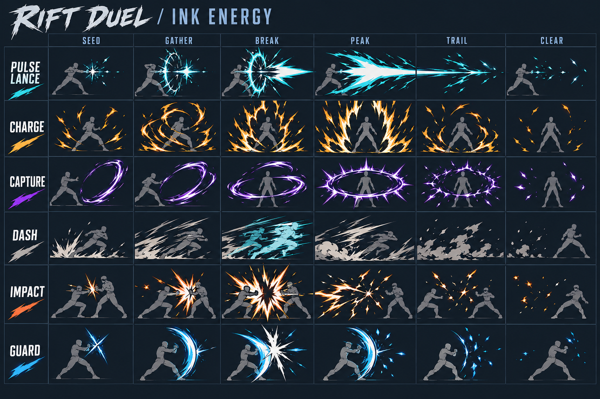
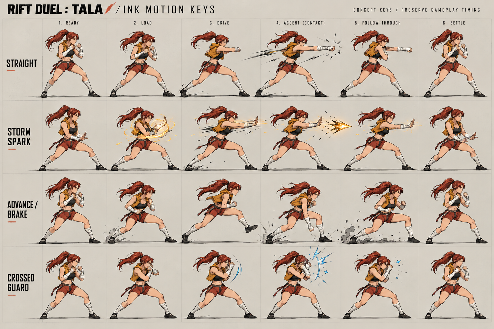
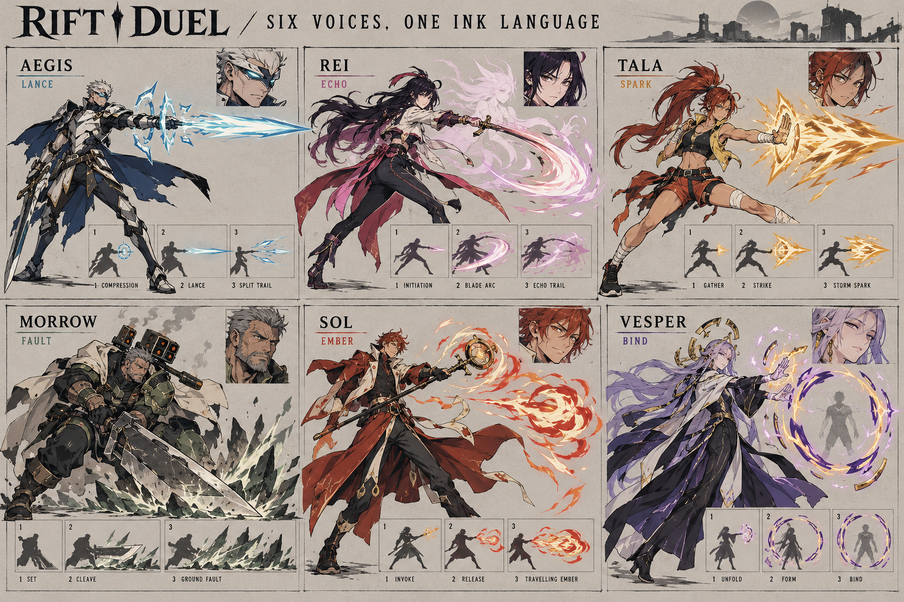
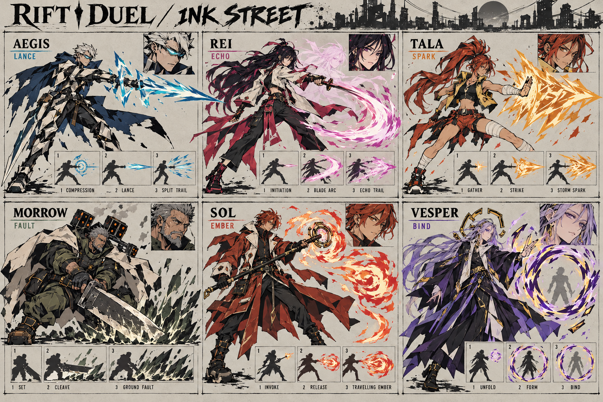

# Rift Duel — Ink Energy concepts

Original concept work, 26 October 2026. **Awaiting Adam's art-direction choice.** Created with the built-in image-generation tool. No runtime character, animation, gameplay or effect files changed.

Start with **Ink Street** for the character direction and **Energy Sequences** for attacks. The fantasy option is retained for comparison, not silently approved as the new roster.

## Boards

### Attack and movement effects — six sequential keys per row

Pulse Lance, charge, capture, dash, impact and guard. Read each row independently from left to right. The capture stays an open binding ellipse around a visible opponent. White cores, coloured hard edges and negative-space cuts give attacks their shape; broad blur is not the main design tool.

### Tala — attack and movement key poses

Four six-key sequences: straight, Storm Spark, advance/brake and crossed guard. A corrected release cell retains Tala's body and shows one compact travelling shot. These are selected keys, not 24 consecutive gameplay frames. Her straight, cross and hook remain distinct gameplay actions; this sheet only explores the straight.

### Character direction A — fantasy

### Character direction B — Ink Street (recommended for these references)

Both retain original roster roles and colours. B emphasises stronger black shapes, sharper costume planes and practical cuffs/footwear. Neither is an approved model replacement. It still contains more costume fragmentation than a final gameplay model should carry.

## Source study and what it establishes

- User's ten attached illustrations: visual reference for angular faces, irregular confident outlines, asymmetrical clothing, large black areas, restrained material rendering and individual silhouettes. These observations do not identify uncredited artists or assert shared historical influences.
- [Sol Badguy sprite compilation by arzeer](https://www.deviantart.com/arzeer/art/Sol-Badguy-spritesheet-part-1-896927745): full sheet visually inspected. Attack strips show pronounced changes in torso/weapon direction, large white slash wedges, separate flame shapes and recovery drawings; effects change silhouette across a sequence. Sheet layout alone does **not** establish playback durations or hit frames.
- [BlazBlue MUGEN resource thread](https://mugenfreeforall.com/topic/14339-blazblue-complete-resource-thread/): documents separate character-effect resources and colour-separated character sprites. It is a community distribution/reference index, not a production specification or proof of original timing.
- [Noel Centralfiction asset inventory](https://www.spriters-resource.com/pc_computer/blazbluecentralfiction/asset/108875/) and [May Accent Core +R inventory](https://www.spriters-resource.com/pc_computer/guiltygearxxaccentcoreplusr/asset/581993/): show separate effects and pose assets. Inventories were readable; direct archive access failed, so no claim is made to have inspected every animation within them.
- [Arc System Works' Xrd presentation announcement](https://www.arcsystemworks.com/guilty-gear-xrds-art-style-the-x-factor-between-2d-and-3d-talk-from-gdc-2015-is-now-available-online/): primary confirmation of the goal of preserving a 2D visual character in a 3D framework. The linked presentation/PDF was unavailable during this pass. Detailed Xrd implementation has not been reverse-engineered here.

The following production choices are **our proposals**, not measured Arc System Works or Evil Zone frame data. Original source sprites are not included in the repo or game.

## Production handoff for Codex and Claude

Keep 3D fighters and the current combat controller. Author 2D effect sequences as separate layers attached to hand/weapon/ground/world anchors. Use selected drawn accent shapes and deliberately timed pose changes; do not lower simulation frequency or apply a universal choppy frame rate.

| Fighter | Shape language | Keep the current move identity |
| --- | --- | --- |
| Aegis | Cyan-white narrow lance, broken angular emitter crest | Pulse Lance is a straight travelling beam; paid pulses remain separate emissions. |
| Rei | Rose blade arcs and delayed pale spirit | Crescent Wing remains a spirit shot; Echo Blade remains a spectral sword. The roster's sword cut is a melee motif, not a replacement for either shot. |
| Tala | Amber compact jagged sparks and tightly drawn fist smears | Storm Spark is one travelling shot; Still-water Discus remains a disc. No permanent beam attached to her palm. |
| Morrow | Sage/ivory ground wedges, black grit and heavy steel arcs | Fault Line stays low; Siege Salvo remains eight missiles in four pairs. The greatsword does not replace missile attacks. |
| Sol | Vermilion/cream hooked flame shapes | Quick fire shot versus retreating knockdown flame remain distinct. This is Rift Duel's staff scholar. |
| Vesper | Violet/gold broken open ellipses | Event Horizon remains a travelling snare; generic capture stays visibly open. |

### Timing contract

Baseline: `dist/moves.js`, `dist/base-specials.js`, `dist/special-variants.js` at `a2f3c0f`.

- Tala straight startup/contact: simulation frame **5**. Proposed pose samples at 0 ready, 2 load, 4 drive, 5 contact, 8 carried recovery, 19 settle. Preserve existing combo and hitstop handling; the illustrated recovery needs elbow folding before it is production-ready.
- Tala forward Storm Spark releases at frame **9**; recovery is 22 frames. Proposed samples: 0, 3, 7, 9, 15, 31. Projectile lifespan is controlled separately.
- Generic capture starts at frame **13**; recovery is 40 frames. The binding ring starts on confirmed capture, follows the cinematic victim, then breaks apart on exit. Do not trigger a successful binding graphic on a miss.
- Charge: preparation/gather, a separately looping held section, and cancellation/release. Do not loop the entire six-column board.
- Dash: push-off, acceleration, smear, foot catch, dust tail, clear. Actual feet and travel state own displacement; the afterimage cannot add movement.
- Impact and guard: effect trigger uses existing hit/block/deflect events. Big white accents should be brief local marks, with a restrained variant for Reduce motion.

### Buildable asset specification (next pass)

1. Redraw/extract approved effects **without** the embedded mannequins, labels, paper/grid or background. Do not slice these boards directly.
2. Export each action on transparent RGBA cells with a stable pivot, explicit frame rectangles and padding. Suggested starting cells: 256 square for sparks/dust, 512 square for charge/capture, 512×256 for beam head/tail. These are proposed budgets, not delivered files.
3. Separate beam muzzle, travelling head, stretchable body and tail. Preserve core width when stretching and drive each paid pulse independently.
4. Use facing planes or crossed ribbons for travelling effects and camera-readable impact cards. Split capture front/back arcs if needed so the ring wraps convincingly around a 3D target rather than always reading as a HUD reticle.
5. Verify alpha edges, sorting/depth testing, clipping, visibility on light/dark arenas and all three fight cameras. Keep the transparent-pass arena-overdraw regression from ATTACK-FX.
6. Review one complete Tala action plus Aegis's beam at normal speed before expanding to the roster. Claude can use the pose sheet for rig keys; effects implementation remains a separate lane.

## Review limits

All four boards were visually inspected and are 1536×1024. They are **opaque illustrated concept boards**, not alpha atlases or tested animations. Cell borders/labels consume space; beam art crosses a grid boundary. Tala's advance step is exaggerated and her recovery keys need further mechanical refinement. The roster panels omit some footwear behind mini-strips and are not turnaround/model blueprints. Runtime conversion and full animation coverage remain undone.

Exact generation prompts: [prompts.json](prompts.json). Corrections and alternate-direction prompts: [edit-prompts.json](edit-prompts.json). Dimensions and hashes: [asset-manifest.json](asset-manifest.json).
