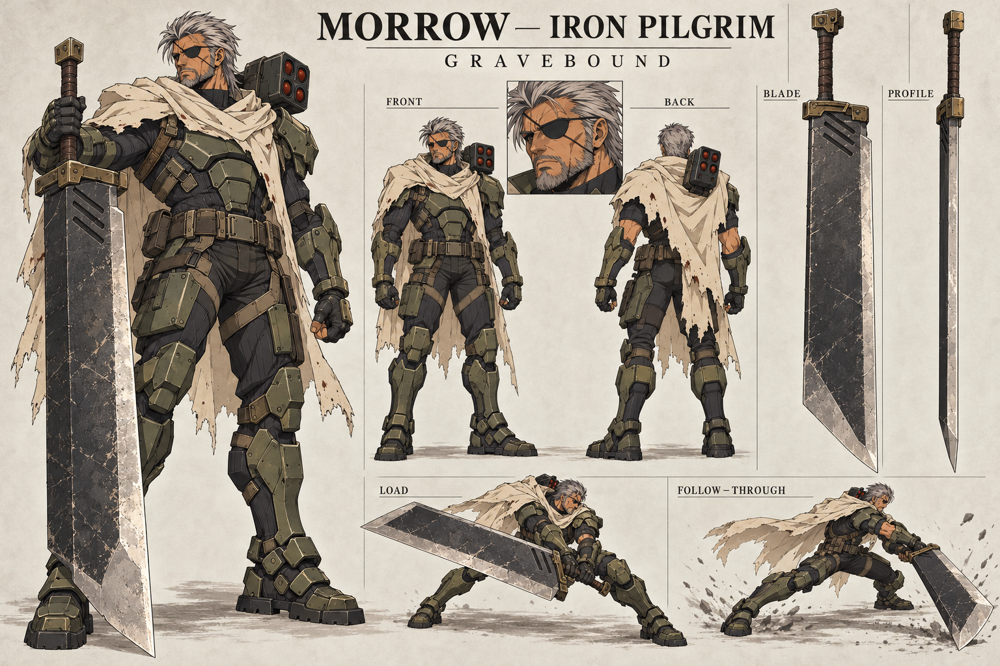

# Morrow — Gravebound sword redesign

New concept work requested by the user: give Morrow a much bigger greatsword combining the oversized scale associated with Cloud Strife and the brutal slab weight associated with Berserk, while retaining an original character and weapon design. **Concept art only; no live model, weapon reach, hitboxes or animation timing changed.**

## Design

Working weapon name: **Gravebound**.

- Nearly fighter-height overall, with a broad dark forged-steel blade, thick spine, worn bright cutting bevel and a clipped angular tip.
- Short substantial asymmetrical guard, long wrapped two-handed grip and squared counterweight pommel.
- Three shallow diagonal forge grooves near the blade base distinguish it from the reference weapons; no copied round sockets or franchise insignia.
- Proposed modeling proportions: overall length 0.95 × standing height; blade length 0.73 × height; width approximately 0.65 × shoulder width. These are design targets, not measurements taken from the generated image or changes to combat range.

## Morrow's identity

Retain the Iron Pilgrim working concept: mature weathered veteran, swept silver hair, eyepatch, short beard, olive segmented armor, charcoal undersuit, ivory worn asymmetrical mantle and heavy boots. Reinforce the sword-side arm/shoulder and belt. Keep the compact shoulder missile pod on the opposite side and the mantle clear of the sword's two-handed travel. Do not substitute a casual shirt, Cloud's clothes, or Guts' armor.

## Motion translation

The action thumbnails communicate intent, not a finished animation sequence. Use the supporting foot and hips to load the blade; the torso and shoulders follow. Hands stay separated on the long grip. Recovery catches momentum through bent knees and a step rather than stopping the sword abruptly. Ground-rest poses are for idle/ceremony, not a mandatory input delay.

When implemented, preserve responsive startup and exact existing damage-frame timing unless a separate gameplay change is requested. Check the broad blade against torso, launcher, mantle, ground and opponent from the actual fight camera. A larger visible weapon does not automatically authorize a larger hitbox.

Exact image-generation prompt is stored beside the board. Based on the original roster's Morrow option A. This new sword direction comes directly from the user's request; other roster concept alternatives remain unchanged.

## Image review

The hero view establishes the enlarged blade and retains the veteran identity, mantle, armor and shoulder launcher. Front/rear and sword detail views support model planning. The action thumbnails vary blade proportions and exaggerate the follow-through lunge; use the hero/isolated blade and written ratios to establish the model rather than treating every drawing as measured geometry. The narrow profile is illustrative, not a technical cross-section. Fix guard handedness and groove count in the model specification if the generated views disagree.

## Runtime implementation

`dist/morrow-gravebound.js` dresses the existing Design 03 anatomical model when Morrow attaches. It adds independent joint-parented armor shells, an ivory cloth tail on the existing mantle joint, a four-port shoulder launcher, an eyepatch and the Gravebound sword. The old weapon meshes are removed. Stock clothes remain beneath the armor as a charcoal deforming underlayer because the source body is masked beneath them.

`dist/morrow-review.html` loads exactly this attachment and the game's animation; it is not a separate showcase model. Front, side and back views and idle, guard, movement, recoil and three cuts are available. The weapon's long axis follows the existing hand's +Z convention. Its visual bounds are approximately 2.9 units on a 2.9-unit standing fighter; the blade is 2.24 units long and 0.62 units wide before bevels. Gameplay reach and damage timing are unchanged.

This is a runtime costume interpretation, not a newly sculpted likeness. Silver swept locks and a beard fitted to the source jaw establish the veteran silhouette, but the facial anatomy still needs a dedicated likeness pass; the animation retains the existing right-hand weapon grip rather than implementing the concept's two-hand choreography. Those differences must remain visible in review notes.
