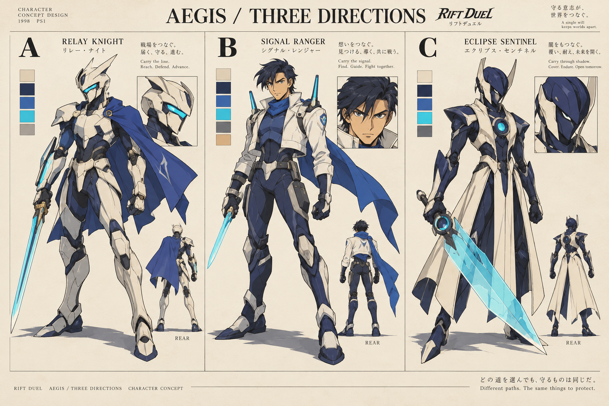
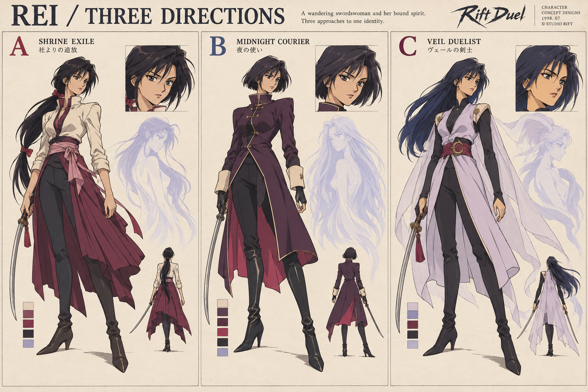
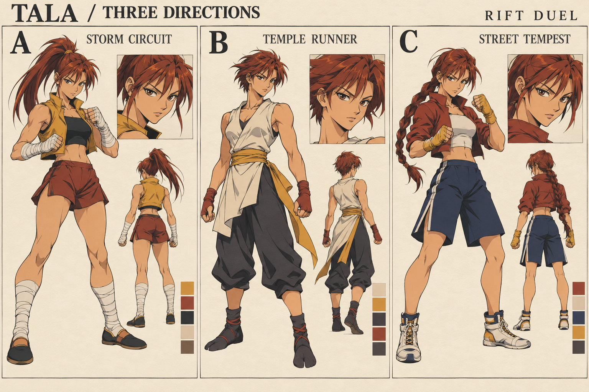
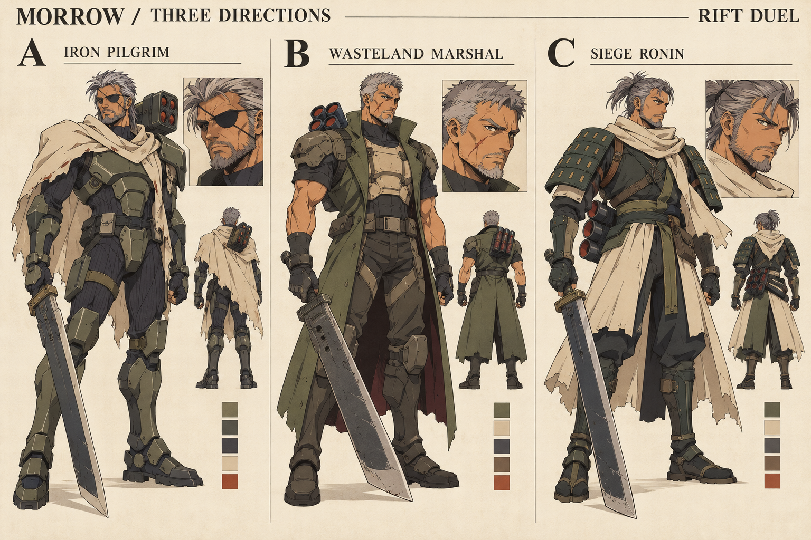
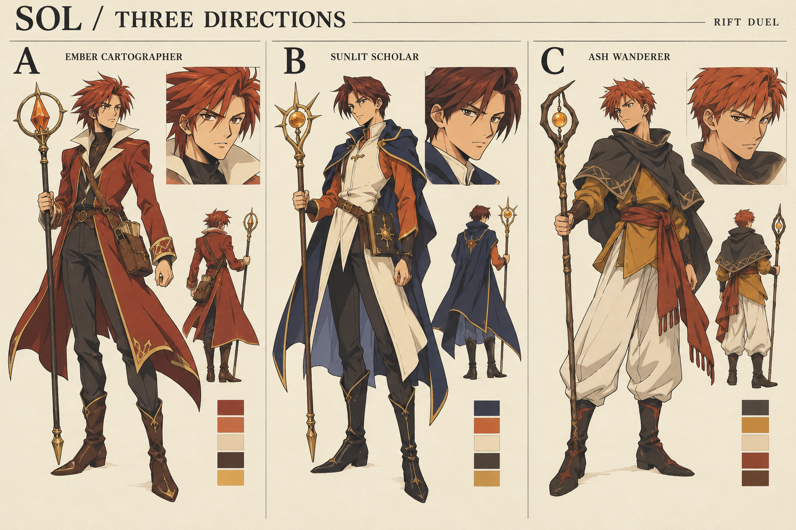
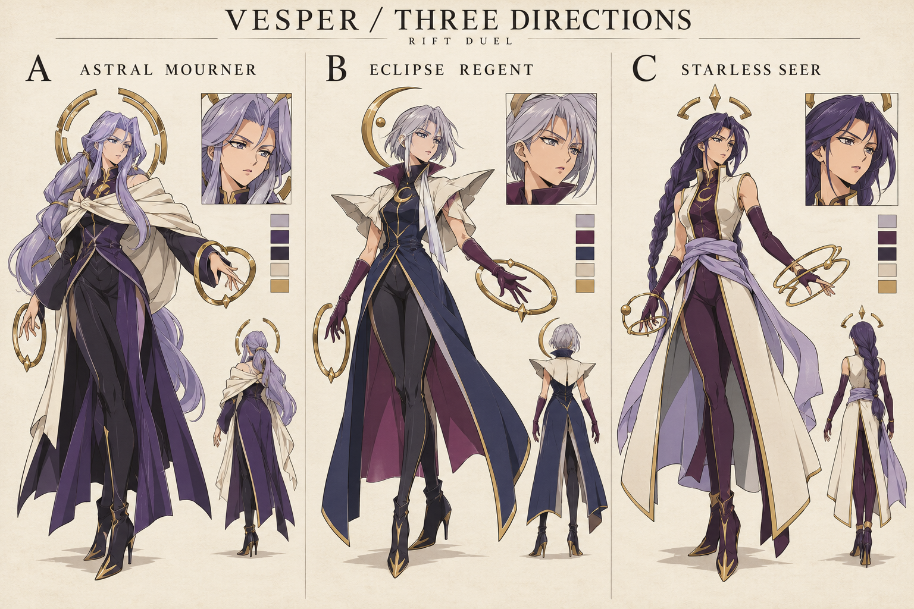

# Rift Duel — character art options

Created October 21, 2026 with the built-in image-generation tool. **18 visual options across six concept boards, plus six 16-pose sprite-reference sheets (96 pose thumbnails).** These are new original concepts, not game screenshots or historical production assets.

Choose A, B or C independently for each fighter. Pose sheets use A provisionally. The move guide also offers three motion directions per fighter.

[Research and visual criteria](RESEARCH.md) · [Moves, cell labels and cleanup notes](MOVE_GUIDE.md) · [Exact prompts](prompts.json) · [File checks](asset-checks.json)

The sprite references have alpha but are not ready for automatic slicing or playback. No live-game art was replaced.

## AEGIS

**A** Relay Knight | **B** Signal Ranger | **C** Eclipse Sentinel

[Open 16-pose sheet](aegis-poses.png)

## REI

**A** Shrine Exile | **B** Midnight Courier | **C** Veil Duelist

[Open 16-pose sheet](rei-poses.png)

## TALA

**A** Storm Circuit | **B** Temple Runner | **C** Street Tempest

[Open 16-pose sheet](tala-poses.png)

## MORROW

**A** Iron Pilgrim | **B** Wasteland Marshal | **C** Siege Ronin

[Open 16-pose sheet](morrow-poses.png)

## SOL

**A** Ember Cartographer | **B** Sunlit Scholar | **C** Ash Wanderer

[Open 16-pose sheet](sol-poses.png)

## VESPER

**A** Astral Mourner | **B** Eclipse Regent | **C** Starless Seer

[Open 16-pose sheet](vesper-poses.png)
