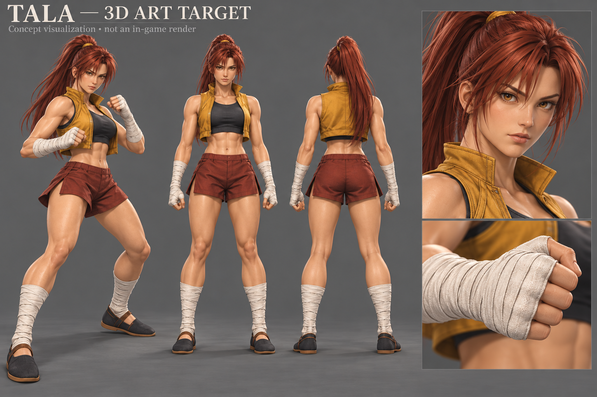

# Tala: character art priority, 22 October 2026

The user clarified that the current animation is substantially satisfactory and the priority is character design and visual finish comparable in spirit to DOA3, Tekken 4 and Soulcalibur. Preserve responsive combat and the established animation while improving the actual asset. The generic MakeHuman base is a starting mesh, not evidence the art target has been achieved.

This is newly generated concept visualization based on the established Design 02 board. It is NOT an in-game screenshot, exported 3D model, texture atlas, or completed asset upgrade. Exact generation prompt is alongside it. No game assets changed in this art-reference delivery.

## What the actual model must carry

- Face: tapered jaw, deliberate brow and almond eyelid silhouette, visible warm irises, shaped lips, adult stylized proportions. Avoid copying a generic generator face unchanged.
- Hair: side-swept segmented bangs and temple locks, a clear high ponytail attachment and directional auburn highlights. Match silhouette before adding finer strand detail.
- Costume: actual open ochre vest with collar, hem thickness and armholes over charcoal top. Replace the recolored sportsuit rather than trying to shade it into a different garment. Rust shorts have waistband, side vents and broad tension folds; no random stripe pattern or body intersections.
- Hands/legs: ivory wraps with purposeful overlapping bands; combat fists with thumb outside fingers; fitted shin wraps and thin-soled dark martial shoes.
- Materials: separate skin, woven cloth, wraps and shoe surfaces at the real fight-camera distance. Texture detail should reinforce shape, not substitute for it.

## Review of this generated board

The costume and warm/cool color masses retain the original direction. The face and layered bangs communicate the desired authored identity. It still renders more hair strands, skin sheen and fabric microdetail than necessary for an early-2000s-inspired runtime asset. Simplify these in implementation. Views are illustrative, not aligned orthographic tracing references; ponytail length and garment folds vary. The large fist detail requires anatomical checking before modeling. This board does not establish what the reference games historically rendered.

## Acceptance for the next model revision

Compare the actual front, profile, rear and face close-up with this target under neutral light. Then inspect crossed guard, the three punch contacts, movement and recoil on the existing live rig. Preserve the 0.57.1 unequal-leg solver and Design 03 review binding. Require a visible improvement to face, hair and costume together before presenting another major art milestone. Tests are compatibility checks, not a measure of aesthetic quality.
