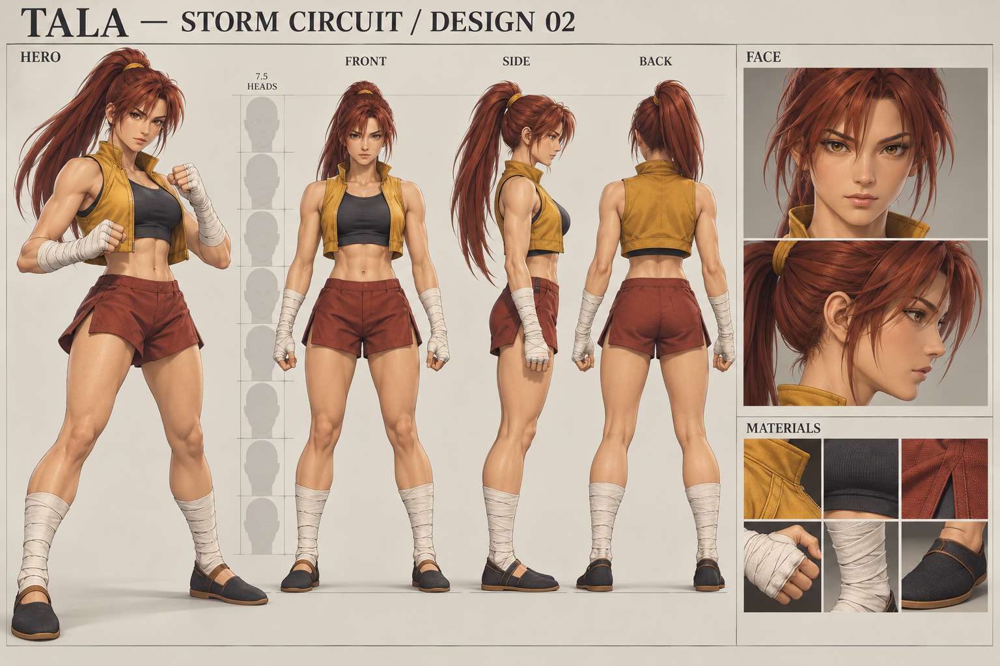
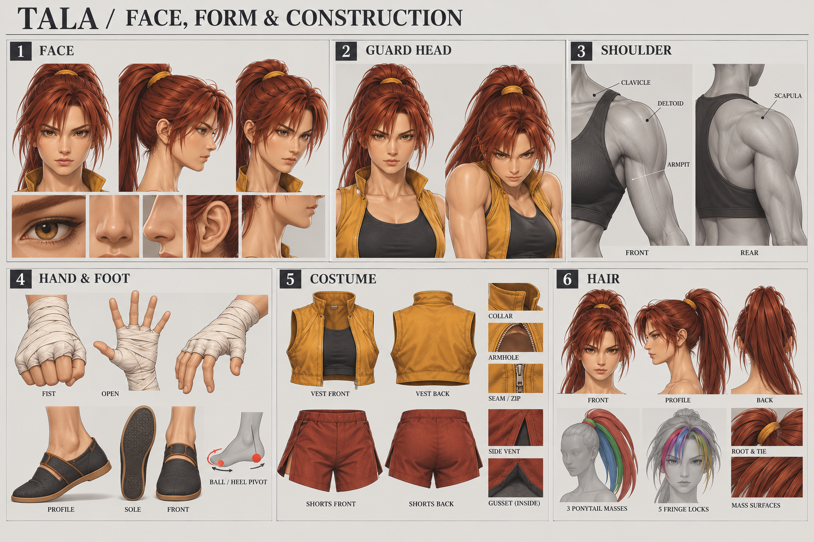
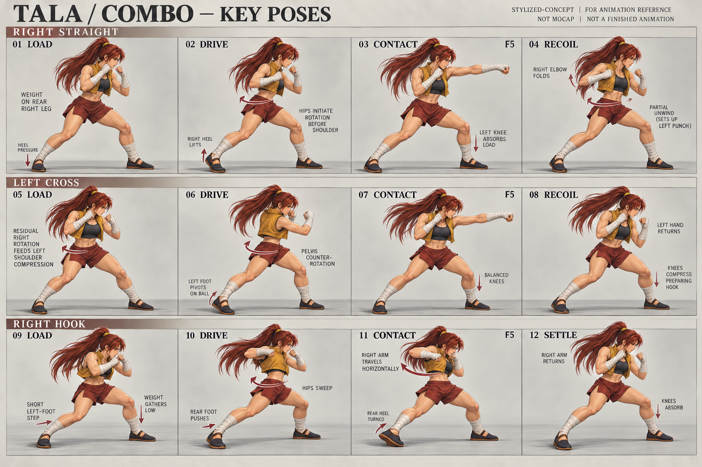
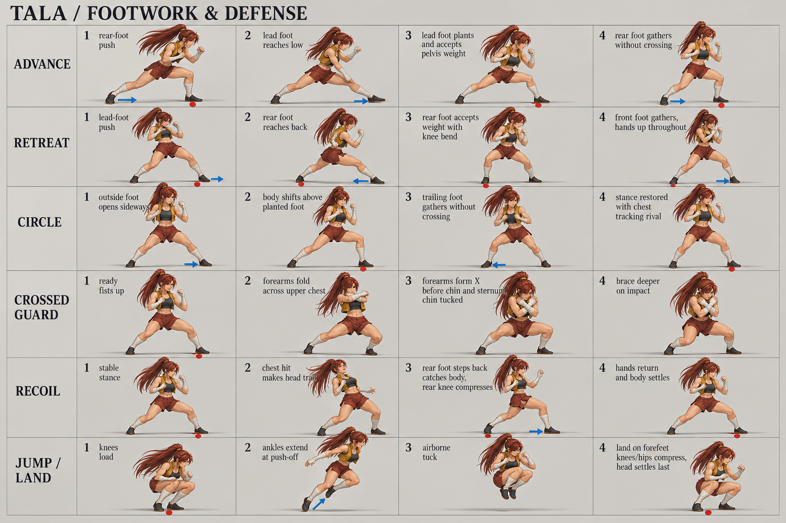
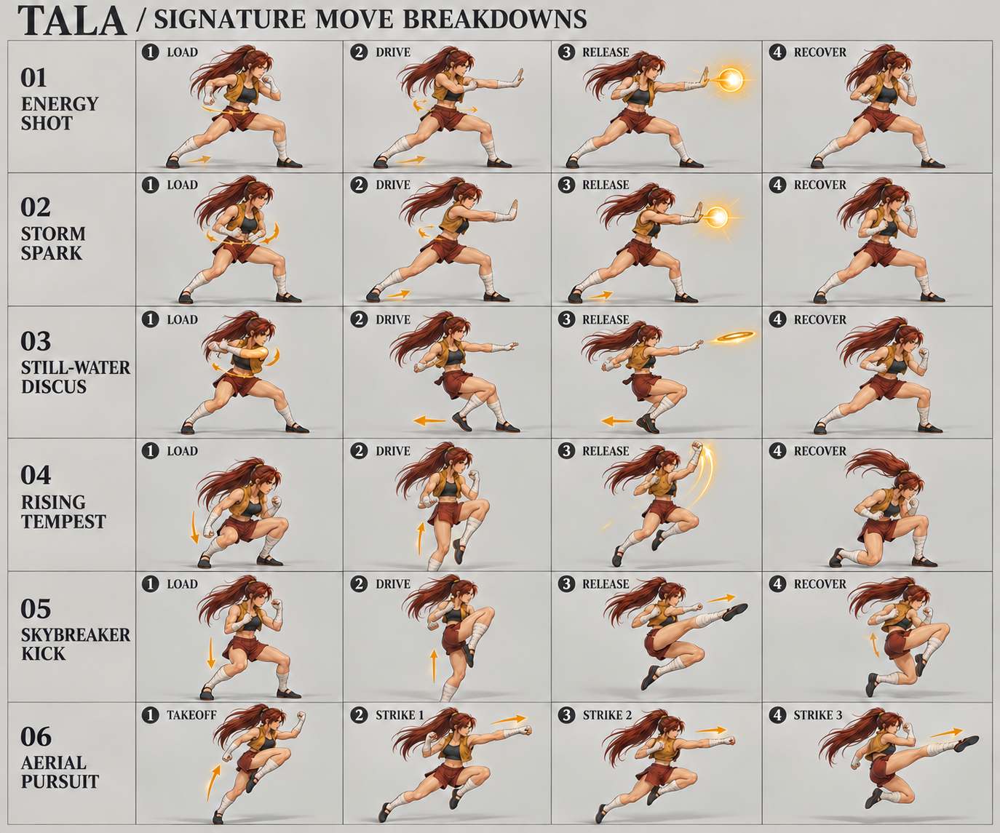

# Tala — Storm Circuit / Design 02

Original concept and animation planning package, 21 October 2026. **This is the proposed next model, not a screenshot of the live game or a finished animation asset.** The current Alpha 0.51 model is unchanged.

Primary direction: early-2000s Japanese 3D fighter, led by Dead or Alive 3's softened stylized realism. Retain Tala's original identity and Evil Zone-inspired combat. Use grounded anatomical posing and carefully constructed costume surfaces, rather than simply stretching the previous mesh.

## Visual boards

Click any board for its full resolution.

### 1. Character, turnaround and palette

### 2. Face, neck, anatomy, hands, shoes, costume and hair construction

### 3. Three-hit combo: load → drive → contact → recover

### 4. Advance, retreat, circle, crossed guard, recoil and jump

### 5. Projectiles, rush, kick and aerial pursuit

## Build documents

- [Production guide: face through export, ordered work and acceptance checks](PRODUCTION.md)
- [Animation specification: local frames, foot support, all move families and transitions](ANIMATION.md)
- [Research: sources, observations, limitations and decisions](RESEARCH.md)
- [Machine-readable timing manifest](timing.json) and [regeneration script](../../scripts/tala-design-timing.mjs)
- Exact built-in image-generation prompts: [character](prompt-01.txt), [construction](prompt-02.txt), [combo](prompt-03.txt), [footwork](prompt-04.txt), [signatures](prompt-05.txt), [signature correction](prompt-06.txt).

## Image review and authority

These are generated production references, not measured orthographic drawings, motion capture, runtime sprite atlases, or usable UV textures. Written specifications and game move data govern when an illustration conflicts with them.

- The first sheet is a polished design target with finer hair/fabric detail and glossier skin than the proposed runtime model. Simplify strands and surface grain; reduce skin gloss. Its ruler is illustrative: establish actual 7.5-head anatomy in Blender, excluding ponytail.
- Front/side/back drawings need manual landmark alignment before tracing. The side arms obscure some torso structure; the construction guide supplies the intended anatomy.
- Combo sheet contact panels do not reliably distinguish left from right. Enforce **right / left / right** with named bones, not by tracing the drawings. Hook contact must extend into the target plane; the drawn hook is too close to the chest.
- The footwork sheet exaggerates stride and crouch. Do not copy its wide lunge as ordinary walking, or its deep guard squat as the hold pose. Keep the low step-and-gather described in ANIMATION.md. Some colored arrows/foot dots are illustrative and do not consistently identify the correct support foot.
- Use the corrected signature board. It fixes the original's two-orb Storm spark (base is ONE shot) and backward-hop direction. Even the corrected discus image tucks the knees too much: runtime hop height remains 0.16 units, with release/landing at frame 12. The release illustration shows an airborne design beat, not the exact frame-12 ground contact.
- Takeoff, kick recovery and rising-rush landing drawings are thumbnails. Do not add a knee-on-floor landing or pause input to match them. The written timing chart is authoritative.

Five main boards cover the model and core action families. Stock variants, captures, burst, dash, roll and exceptional reactions have written breakdowns in ANIMATION.md; they are not falsely presented as finished drawn frame sequences. Each still needs 3D blocking and real-time review before release.

No third-party game art is included in these assets. Reference links are in RESEARCH.md. Generation used the built-in image tool, with the earlier original Tala option A as identity reference. The superseded signature draft is retained as `05-signatures.png` for provenance.
